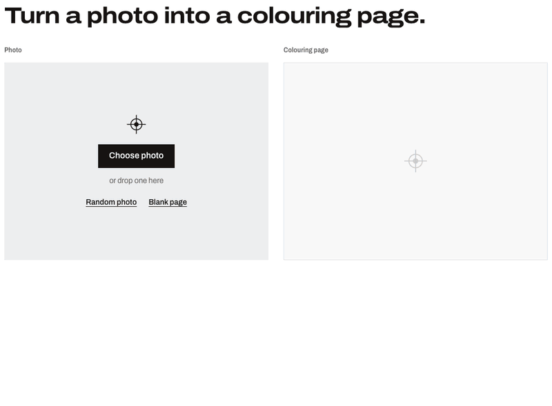
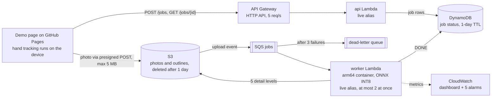

# HoloPaint Cloud

Upload a photo, get back a colouring page: black outlines with their small gaps bridged,
so regions can be flood-filled. It runs on AWS as an event-driven serverless pipeline. The model is
the U-Net I trained from scratch on BSDS500 for
[HoloDraw](https://github.com/Sahan-Madusanka-Perera/HoloDraw).

**Try it: [sahan-madusanka-perera.github.io/holopaint-cloud](https://sahan-madusanka-perera.github.io/holopaint-cloud/)**.
Drop a photo, then paint the page by hand in front of your webcam (or with a mouse).



<sub>Recorded on the live site in headless Chrome. The hand is MediaPipe's own test photo
(Apache-2.0) on a fake webcam; the fills are mouse taps. Walrus photo by Jay Ruzesky on
Unsplash, via Lorem Picsum.</sub>



**Status:** deployed on AWS (Sydney, `ap-southeast-2`) by its own pipeline, monitored, load-tested and live on GitHub Pages; M1–M6 done.

| Milestone | |
|---|---|
| M1 Compress the model (ONNX INT8) + parity gate | ✅ |
| M2 Worker Lambda container + tests + local end-to-end | ✅ |
| M3 Terraform: S3, SQS + DLQ, DynamoDB, Lambdas, HTTP API | ✅ |
| M4 CI (GitHub Actions) + CD (CodePipeline/CodeBuild), smoke test + rollback | ✅ |
| M5 CloudWatch dashboard + alarms, k6 load test, tuning | ✅ |
| M6 Demo page, with painting by hand, on GitHub Pages | ✅ |

## M1: compressing the model without changing its output

The worker runs ONNX Runtime instead of PyTorch. That keeps the Lambda image small
and cold starts fast. The question was how far the model can shrink before the
colouring pages change.

**Method**
1. `worker/pipeline.py` ports HoloDraw's full pipeline to NumPy, with the model
   passed in as a function: global pass with flip TTA, Hanning-blended
   full-resolution tiles, Canny fusion, hysteresis, gap bridging and noise removal.
   `model/check_port.py` runs HoloDraw's original code next to the port. The
   outlines are **pixel-identical**.
2. `model/export_onnx.py` exports to ONNX (opset 17, dynamic batch). The raw
   outputs differ from PyTorch by at most 1e-6.
3. `model/quantize.py` builds two INT8 variants:
   - *static*: QDQ, per-channel weights, activations calibrated on 120 tiles from
     BSDS500 **train** images
   - *dynamic*: weight-only
4. `model/parity_eval.py` runs the whole pipeline on a fixed set of 30 photos (20
   BSDS500 *test* at 481×321, 10 BIPED test at 1280×720). It compares each variant's
   outline with the PyTorch outline (IoU of edge pixels), using 2 CPU threads to
   approximate a 3 GB Lambda.

**Results** (Apple M4, 2 threads)

| model | size (MB) | outline IoU mean | IoU worst | prob. MAE | s/photo 481×321 | s/photo 1280×720 |
|---|---:|---:|---:|---:|---:|---:|
| PyTorch (original) | 118.5 | 1.0000 | 1.0000 | 0.00000 | 0.54 | 3.64 |
| ONNX FP32 | 118.4 | 1.0000 | 1.0000 | 0.00000 | 1.72 | 8.58 |
| ONNX INT8 dynamic | 37.6 | 0.9928 | 0.9796 | 0.00199 | 0.68 | 3.40 |
| **ONNX INT8 static** | **29.7** | **0.9907** | **0.9821** | 0.00326 | 0.59 | 2.94 |

**Decision: deploy INT8 static.** It is 4× smaller with 99% outline overlap. Even
the worst photo (98.2%) is visually indistinguishable from the original. The CI
parity gate fails the build if any photo drops below **0.97 IoU**.

**Caveats**
- On the M4, INT8 is only modestly faster than PyTorch (about 1.2× on HD photos), so
  the main win is size, which drives image size and cold-start time. FP32 ONNX is
  slower than PyTorch on this machine. Speed on Lambda's Graviton CPUs gets measured
  in M5, and those are the numbers that count.
- Post-processing takes about 0.05 s. Nearly all the time goes to running the
  model on 18 tiles plus the global pass for an HD photo.

## M2: the worker Lambda, built and tested locally

`worker/handler.py` is invoked by SQS with S3 upload events. For each upload it
loads the photo, runs the pipeline, writes `results/<job_id>.png` and marks the job
`DONE` in DynamoDB.

- **Hostile input** (`worker/photo.py`): byte and pixel limits are checked from the
  header before decoding (decompression bombs). Only real JPEG/PNG/WebP files pass,
  whatever the file name says. EXIF rotation is applied, then all metadata is
  dropped. The longer side is capped at 1600 px.
- **At-least-once delivery:** a job already `DONE` is skipped, and re-processing writes
  byte-identical output to the same key.
- **Failures:**
  - A bad upload is marked `FAILED` once and never retried.
  - Transient errors are returned as SQS *partial batch failures* and retried.
  - On the final attempt the job is marked `FAILED` before the message goes to the
    DLQ, so a user never waits on a job that will never finish.
- **Observability:** Powertools JSON logs and EMF metrics (`JobLatency`,
  `TilesPerImage`, `JobsFailed`, `JobsRejected`, cold starts).

**Tests:** 29 pytest tests (`worker/tests`). Photo validation, a golden outline,
and handler behaviour against moto (fake S3 + DynamoDB): success, duplicate
delivery, identical re-processing, a rejected upload, retry then fail on the last
attempt, S3 test events, path tricks, and a mixed batch.

**Container:** AWS's Lambda Python 3.12 base image for arm64. It holds no PyTorch,
only ONNX Runtime and the 30 MB INT8 model (`worker/Dockerfile`, allow-list
`.dockerignore`), 301 MB in total. `scripts/local_e2e.py` runs the real image (with the
Lambda Runtime Interface Emulator inside) beside a moto server and checks
upload → DONE → PNG.

| 640×480 photo, container capped at 2 CPUs / 3008 MB | per photo |
|---|---:|
| ONNX Runtime default threads | 4.47 s |
| **`ORT_THREADS=2`** (match the CPU quota) | **1.34 s** |

**Thread oversubscription:** inside a CPU-capped container, ONNX Runtime sized its
pool from all 10 host cores. Pinning it to the 2-CPU quota made inference 3.3×
faster. The Lambda sets `ORT_THREADS` to match its vCPUs.

**Portability:** given the same lossless input, the Linux arm64 container's outline
is **pixel-identical** to the macOS one (`worker/tests/golden/`).

## M3: infrastructure as code, deployed

Two Terraform stacks, both built from reusable modules (`private_bucket`, `queue`,
`jobs_table`, `worker`, `api`):

- **`infra/bootstrap`**: the remote-state bucket (S3-native locking with
  `use_lockfile`, no DynamoDB lock table), a versioned model-registry bucket, and
  the ECR repository. ECR uses immutable git-SHA tags, scans on push, keeps the
  last 5 images, and lets only Lambda pull. Bootstrap's own state lives in the
  bucket it created.
- **`infra/app`** (29 resources):
  - A TLS-only media bucket that deletes everything after 1 day, with CORS for the
    demo origins.
  - Upload events go to **SQS**, with a **DLQ** after 3 attempts and a visibility
    timeout of 6× the worker timeout.
  - The **worker Lambda** (arm64 container, 3008 MB, `ORT_THREADS=2`) is invoked
    through a `live` alias, with partial batch failures and a cap of 2 concurrent
    invocations as the cost ceiling.
  - A **DynamoDB** jobs table (provisioned 5/5, TTL).
  - A throttled **HTTP API** (5 rps, burst 10) in front of the API Lambda.
  - Each function gets its own least-privilege role, and logs are kept for 14 days.

No access keys exist anywhere. `scripts/tf.sh` runs Terraform with the short-lived
credentials from `aws login`.

**Live smoke test** (`scripts/smoke_test.py`) drives the deployed system the way a
browser does: create a job → upload through the presigned POST → poll → download
the PNG. It also checks that S3 rejects a non-image upload and that the API
rejects bad job IDs.

| Measured on Lambda (arm64, 3008 MB) | |
|---|---:|
| Cold start (init: image + imports + model load) | 9.2 s |
| Warm, 640×480 photo | ≈ 5.1 s |
| Upload → DONE, end to end | 5.7–9.0 s |
| Peak memory | 714 MB |

Inference is about 3.8× slower than on an M4. arm64 Lambdas run on Graviton2, which
is much slower per core and has no `i8mm` INT8 instructions. Tuning that (memory,
threads, FP32 vs INT8) is M5.

**What deploying caught:**
- **Presigned POSTs pointed at S3's global endpoint**, which answers `307` for new
  buckets outside us-east-1. Browsers won't follow a redirect on a cross-origin
  upload. The API now signs against `s3.<region>.amazonaws.com`, and a unit test
  pins it.
- **ECR's scan found 12 HIGH CVEs** (openssl, pcre2, curl, rpm), all in the Lambda
  base image's Amazon Linux packages. A plain `dnf upgrade` was a no-op, because
  AL2023 locks repositories to the image's release. `dnf upgrade
  --releasever=latest` took the image from 12 HIGH / 20 MEDIUM / 5 LOW findings
  to **0**.

### Demo page

`web/` is a static page (no build step), styled as a printer's proof sheet. The
photo is the colour proof, the colouring page is the black plate, and the CMYK colour
bar is the job's state: upload, queue, trace, ready.

The browser does the cheap work first. It decodes the photo, applies EXIF
rotation, flattens it onto white and caps it at 1600 px as a JPEG. Then it uploads
straight to S3 and polls the job.

GitHub Pages serves it (`.github/workflows/pages.yml`, on every change to `web/`).
`config.js` isn't in git: the workflow writes it from the `HOLOPAINT_API` repository
variable, after checking it looks like an API Gateway URL. Locally:

```bash
cp web/config.example.js web/config.js   # set window.HOLOPAINT_API to the api_url output
python3 -m http.server 8000 -d web       # open http://localhost:8000 (an allowed CORS origin)
```

### Detail levels

HoloDraw lets you step the edge threshold with `+`/`-` before painting. The worker
does the same work up front: one model pass, then the post-processing at five
thresholds (0.55, 0.45, 0.40, 0.35 and HoloDraw's default 0.30), written as five
PNGs. The page switches between them instantly with a **Detail** ladder (or `[` and
`]`), and the paint stays put. The default level is the most detailed one whose
outline is at most 20% ink. On textured photos (foliage, gravel) 0.30 gives
30–60% ink, which is too dense to colour, and the suggested level drops to 0.35–0.40.

The extra levels cost 0.3–1.5 s on top of a 7.5 s trace for a 1600×1200 photo (M4,
2 threads), run on two threads in parallel. The most detailed level keeps the old
result key, so it is still byte-for-byte HoloDraw's output.

### Paint by hand

Once the page is ready, **Paint by hand** opens the camera and you colour the page in
the air, as in HoloDraw. The cloud does the heavy model; the browser does the
real-time part. MediaPipe's hand landmarker runs in the page (WebAssembly, GPU when
available) at about 30 fps, and no video frame leaves the device.

| Gesture | Action |
|---|---|
| Point (index finger) | Brush, erase, or size a shape |
| Pinch | Fill the region, or pick from the tray |
| Two fingers | Move without painting, or place the shape |
| Three fingers | Hold the page: move to pan, push toward the camera to zoom |
| Fist | Undo |
| Thumb up | Redo |

Everything HoloDraw and its HoloPaint mode can do is here:

- **Tools:** brush, eraser, fill, and line, rectangle, circle and ellipse, filled or
  as outlines. A shape is previewed under the lines while you size it.
- **HoloDraw's 20 colours**, three brush sizes, undo/redo and clear (undoable).
- **Zoom and pan up to 5×**, with a loupe that shows where you are on the page.
  Three fingers by hand; trackpad or touch pinch, the wheel, or the keyboard otherwise.
- **Fill mode:** with the fill tool, pointing only aims and a pinch fills.
- **Random photo** from Lorem Picsum, credited to its photographer, as HoloDraw's
  `R` key does.
- **Blank page:** HoloDraw's drawing mode, no photo and no job. A fill stops at the
  paint itself.
- **Keys** follow HoloDraw: `Z`/`Y` undo and redo, `C` clear, `S` save, `N` new
  photo, `F` fill tool, `Shift+F` filled shapes, `I`/`O` or `+`/`-` zoom, arrows pan,
  `0` fit, `Space` fills where the hand points, `[`/`]` detail, `1`–`3` brush size.

A mouse or finger works too: tap to fill, drag to draw, pinch to zoom.

What changed from HoloDraw's code on the way over:

- **Gestures hold at any hand rotation.** HoloDraw compares fingertip and knuckle
  heights, so MediaPipe's own sideways thumbs-up test photo reads as two raised
  fingers and redo never fires. The port compares distances from the wrist instead.
- **One undo per fist.** HoloDraw's undo cooldown hands back the previous gesture,
  which is still undo, so a held fist undoes every frame (9 times in 10 frames).
  Here an action fires once, when its gesture is entered; undo and redo must be
  held for 220 ms, so a hand passing through a fist does nothing.
- **Zoom is a grab, not a joystick.** HoloDraw zooms while the three-finger hand sits
  above where it started and pans while it sits to one side. Here the page stays
  under the hand: it pans with the hand and zooms as the hand comes closer to the
  camera, read from the palm's apparent size. The brush keeps its size on screen,
  so zooming in paints finer.
- **Steadier aim.** A One Euro filter replaces the fixed EMA, a pinch has
  hysteresis, and a fill lands where the fingertip pointed 120 ms before the pinch
  closed, not where closing the pinch dragged it.
- **Paint goes under the lines.** The outline is multiplied over the paint layer,
  so a brush can never cover a line, and fills bleed 2 px under the lines so no
  white halo shows. Undo stores only the rectangle each action changed.

Tested two ways. `node --test "web/tests/*.test.mjs"` runs 24 unit tests: gestures on
hand landmarks from MediaPipe's test photos (pointing, victory, fist, thumbs up, and
a three-finger hand built from the victory photo), push-to-zoom, the zoom and pan
maths, shape geometry and the fill. End to end, headless Chrome with a fake camera
playing those photos drove the live page through 46 checks: the hand brushes, undoes,
redoes, sizes a rectangle and places it; the mouse draws every shape, fills, erases,
clears and zooms; touch pinches; detail switches keep the paint; random and blank
pages work; desktop and mobile layouts don't overflow.

### Deploy

```bash
aws login --profile holopaint
scripts/tf.sh -chdir=infra/bootstrap init -backend-config=bucket=holopaint-tfstate-<account-id>
scripts/tf.sh -chdir=infra/bootstrap apply
scripts/push_worker.sh            # prints worker_image_tag and model_version
scripts/tf.sh -chdir=infra/app init -backend-config=bucket=holopaint-tfstate-<account-id>
scripts/tf.sh -chdir=infra/app apply -var worker_image_tag=<tag> -var model_version=<version>
.venv/bin/python scripts/smoke_test.py "$(scripts/tf.sh -chdir=infra/app output -raw api_url)"
```

## M4: CI and CD, split by what each side may touch

The account's SCP blocks IAM OIDC providers, so GitHub Actions can't assume a role
in AWS. The model weights and the BSDS500/BIPED parity photos also stay private. So
the work is split by what each side is allowed to see:

```
GitHub Actions (public, no AWS)          CodePipeline in AWS (on push to main)
  pytest (38; 9 need the model, skip)      Source   CodeConnections -> GitHub
  web unit tests (24)                      Build    arm64 CodeBuild: pytest (47) with the real model
  terraform fmt + validate (3 stacks)               build the worker image
  arm64 image build + Trivy                         parity gate inside that image
    (fail on fixable HIGH/CRITICAL)                 push :<commit> to ECR
                                           Deploy   terraform apply infra/app
                                                    smoke test the live system
                                                    failed? move both aliases back
```

- **The parity gate runs inside the image about to ship**, on Graviton, against
  outlines the original PyTorch model drew for the 30 parity photos
  (`model/parity_bundle.py` freezes them once into the private model registry).
  No PyTorch is needed at deploy time. It passes at mean IoU 0.9907, worst 0.9821,
  identical to the M1 numbers. Changing the pipeline's default threshold from 0.30
  to 0.35, as a careless edit might, fails it on all 30 photos (worst 0.36).
- **Rollback is an alias move.** Both Lambdas are invoked through a `live` alias.
  `scripts/cd_deploy.sh` records the live versions, applies, and runs
  `scripts/smoke_test.py` (create a job, upload, poll, download the result and all
  five detail levels, check S3 refuses a bad upload). If it fails, it points both
  aliases back at the old versions, smoke-tests again, and fails the pipeline.
  Infrastructure changes are not rolled back, only code.
- **One role per stage.** The pipeline role only moves artifacts and starts builds.
  Build can read the model registry and push to the worker repository. Deploy can
  manage the app stack's resources by name, and the IAM part names the two app
  roles exactly, so a deploy can't edit the CI/CD roles or create new ones.
- **Supply chain:** every GitHub Action is pinned to a commit SHA (trivy-action had
  its tags hijacked in March 2026; v0.36.0 is a clean release after that).
  CodeBuild checks Terraform's zip against HashiCorp's SHA-256, and the provider
  lock files carry hashes for darwin_arm64, linux_arm64 and linux_amd64.
- **Only deployable changes deploy.** The pipeline trigger filters on `worker/`,
  `api/`, `infra/app` and modules, `ci/` and the gate and deploy scripts, so a web
  or docs commit doesn't spend build minutes.

**First run** (commit b25ed1a, arm64 CodeBuild `BUILD_GENERAL1_SMALL`):

| Step | Time |
|---|---:|
| Source → Build → Deploy, end to end | 5 min 40 s |
| Build: 42 tests with the real model | 37 s |
| Build: parity gate inside the image (mean IoU 0.9907, worst 0.9821, same as on the Mac) | 107 s |
| Deploy: `terraform apply` + live smoke test | 1 min 30 s |

**Rollback, demonstrated.** A commit on a throwaway branch slipped the API's upload
limit from 5 MB to 5 KB. Every test passed, because the API's tests read the
constant back, so the pipeline shipped it. From the deploy log:

| | |
|---|---|
| +0 s | the API's `live` alias moves to the broken version |
| +16 s | the smoke test's 20 KB upload is refused by S3 (`EntityTooLarge`, max 5120) |
| +18 s | both aliases are back on the previous versions (worker v4, API v1) |
| +26 s | the second smoke test passes: the previous release is serving again |

The run ends **Failed**, as it should. The broken release served for 18 seconds.
The follow-up is `api/tests/test_limits.py`, which pins the API, worker and page
limits together, so the same slip now fails in CI before it can deploy.

## M5: measured under load, then tuned

**Monitoring** (`infra/modules/monitoring`, deployed by the pipeline): one dashboard and
five alarms to an SNS topic: dead-letter queue not empty, an upload waiting over
5 minutes, worker crashes, retried failures, and API 5xx. All within CloudWatch's
free 10 alarms and 3 dashboards. The worker also reports how long each upload took to
reach it (`DeliveryDelay`, `QueueDelay`) and which CPU it ran on.

**Load test** (`loadtest/flow.js`, k6): each iteration does what the page does: create
a job, upload the photo to S3 with the presigned POST, and poll until DONE. Photos are
three fixed Unsplash photos via Lorem Picsum, fetched at test time. Run from Sri Lanka
against Sydney (310 ms per API round trip).

| Final configuration, 640×480 photos | |
|---|---:|
| Steady 12 photos/min for 5 min: photo ready, median / p95 | **7.1 s / 7.7 s** |
| of which the worker | 3.7 s |
| of which S3 event → worker (SQS alone: 17 ms) | 0.74 s |
| failed jobs, HTTP errors | 0 of 61, 0 of 366 |
| Capacity (10 users in a loop, 2 workers) | **23 photos/min** |

**What the measurements changed:**
- **The memory buys CPU, not memory.** The worker peaks at 1.3 GB, but Lambda gives
  1.7 vCPUs at 3,008 MB against 1 vCPU at 1,769 MB. On the same CPU, 3,008 MB with 2
  ONNX threads is 37–40% faster for 6–18% more per photo, so it stays. Larger sizes
  were not an option: this account caps Lambda at 3,008 MB.
- **Two CPUs for the price of one.** Two workers with identical settings were 40%
  apart. Logging `/proc/cpuinfo` showed why: Lambda's arm64 fleet places environments on
  Graviton2 or Graviton3. Every timing here is compared on the same generation.

  | Worker | CPU | 640×480 | 1600×1200 |
  |---|---|---:|---:|
  | 1,769 MB, 1 thread | Graviton3 | 5.9 s | 36.6 s |
  | | Graviton2 | 8.2 s | 50.3 s |
  | **3,008 MB, 2 threads** | Graviton3 | **3.7 s** | **22.8 s** |
  | | Graviton2 | 5.7 s | 33.1 s |
- **Batches of two.** Under saturation the workers were busy only 63% of the time:
  each SQS hand-off left one idle for about 2.3 s. Taking up to two photos per
  invocation raised throughput from 20.4 to 23.8 photos/min on the same workers and cut
  p95 wait under load from 36 s to 26 s; two simultaneous uploads were no slower. A
  worker won't start a second photo it might not finish before the timeout: it hands
  it straight back to the queue.

**Cost** (Sydney prices from the AWS Price List API, measured times):

| Per 1,000 photos | Graviton3 | Graviton2 |
|---|---:|---:|
| 640×480 | $0.20 | $0.27 |
| 1600×1200 (the most the page uploads) | $0.94 | $1.35 |

The worker is three quarters of it; API Gateway, the API Lambda, S3 and SQS add $0.05
per 1,000. Lambda's always-free tier covers about 24,000–37,000 small photos a month.
Nothing runs when idle: DynamoDB's provisioned 5/5, the alarms, the dashboard and the
custom metrics are all inside always-free limits. The one standing cost is about 1.5 GB
of worker images kept for rollback in ECR (500 MB free in the first year, then about
$0.10 a month). The bill so far is $0.00, with the Free plan's credits untouched, after
development, seven pipeline runs and about 1,000 test photos.

**Known limit: fewer lines, fewer closed regions.** Gap bridging joins line ends
that nearly meet, so the most detailed levels give mostly closed regions. At the less
detailed levels lines are sparse and often end in open space, and a fill then spreads
across the page (on 12 test photos, the largest region at the least detailed level
covers 67–98% of the page). As in HoloDraw, a fill stops at paint, so drawing a line
across a gap closes it. Extending lines to the page border didn't help (I measured
it): the open ends are mid-page.

## Reproduce

Needs the HoloDraw repo next to this one (for the weights and the BSDS500/BIPED
images), or set `HOLODRAW_DIR`.

```bash
uv venv --python 3.12 .venv
uv pip install --python .venv/bin/python -r model/requirements.txt -r worker/requirements-dev.txt
cp ../HoloDraw/holopaint_unet.pth artifacts/

.venv/bin/python model/check_port.py        # port == HoloDraw, pixel for pixel
.venv/bin/python model/export_onnx.py       # -> artifacts/unet_fp32.onnx
.venv/bin/python model/quantize.py          # -> artifacts/unet_int8_{static,dynamic}.onnx
.venv/bin/python model/parity_eval.py --gate unet_int8_static.onnx   # -> results/parity.{md,json}
.venv/bin/python model/parity_bundle.py     # -> artifacts/parity/ (references for the CD gate)
PYTHONPATH=worker .venv/bin/python model/parity_gate.py artifacts/parity --model artifacts/unet_int8_static.onnx

.venv/bin/python -m pytest                  # 47 tests (worker + API)
node --test "web/tests/*.test.mjs"          # 24 tests (gestures, zoom, shapes, fill)
.venv/bin/python scripts/local_e2e.py       # build image, run it against moto, check upload -> PNG

loadtest/fetch_photos.sh                    # three Unsplash photos via Lorem Picsum
k6 run -e API=<api-url> -e SCENARIO=steady -e RATE=12 loadtest/flow.js
k6 run -e API=<api-url> -e SCENARIO=saturate -e VUS=10 -e POLL=3 loadtest/flow.js
```

## Layout

```
model/    unet.py  common.py  check_port.py  export_onnx.py  quantize.py  parity_eval.py
          parity_bundle.py  parity_gate.py
worker/   handler.py  photo.py  pipeline.py  onnx_predictor.py  Dockerfile  tests/
api/      app.py  tests/
infra/    bootstrap/  app/  cicd/  modules/{private_bucket,queue,jobs_table,worker,api,monitoring}/
loadtest/ flow.js  fetch_photos.sh                  (k6)
docs/     demo.gif
ci/       build.yml  deploy.yml                      (CodeBuild buildspecs)
.github/  workflows/ci.yml  workflows/pages.yml
scripts/  tf.sh  push_worker.sh  smoke_test.py  local_e2e.py  cd_deploy.sh
web/      index.html  styles.css  app.js  gestures.js  hand.js  paint.js  shapes.js  view.js  fill.js  tests/
results/  parity.md  parity.json                   (side-by-side PNGs are git-ignored)
artifacts/  weights and ONNX files (git-ignored; S3 model registry from M3)
```
